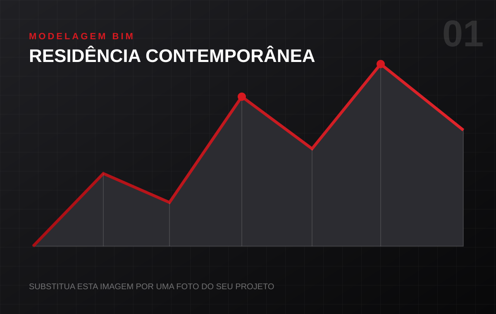

# Portfólio profissional — Gabriel dos Anjos Costa

Site estático em HTML, CSS e JavaScript, pronto para abrir no VS Code e publicar no GitHub Pages.

## Arquivos

- `index.html`: conteúdo e estrutura do site.
- `styles.css`: cores, responsividade e visual.
- `script.js`: menu, animações, abas, sliders, modal e formulário do WhatsApp.
- `assets/`: imagens provisórias dos projetos.

## Como abrir no VS Code

1. Extraia o arquivo ZIP.
2. Abra a pasta `portfolio-gabriel` no VS Code.
3. Abra o arquivo `index.html`.
4. Para visualizar, instale a extensão **Live Server** e clique em **Go Live**, ou abra `index.html` diretamente no navegador.

## Informações que precisam ser substituídas

Pesquise no projeto pelos textos abaixo:

- `(00) 00000-0000`
- `+5500000000000`
- `5500000000000`
- `seuemail@exemplo.com`
- `seuusuario`
- `CREA-GO: 000000/D`

No WhatsApp, use somente números: código do país `55`, DDD e número. Exemplo fictício: `5564999999999`.

## Como trocar as imagens

1. Coloque suas imagens na pasta `assets`.
2. No `index.html`, encontre uma linha como:

```html

```

3. Substitua pelo nome da sua imagem:

```html

```

Use imagens em formato horizontal, preferencialmente com proporção próxima de 16:10 e boa resolução.

## Como alterar o tempo do carrossel

No arquivo `script.js`, localize:

```javascript
window.setInterval(() => showSlide(currentIndex + 1), 3000);
```

`3000` significa 3 segundos. Para 5 segundos, use `5000`.

## Publicação no GitHub Pages

1. Crie um repositório no GitHub.
2. Envie todos os arquivos da pasta para a raiz do repositório.
3. Abra **Settings > Pages**.
4. Em **Build and deployment**, selecione **Deploy from a branch**.
5. Escolha a branch `main` e a pasta `/root`.
6. Salve. O GitHub fornecerá o endereço público do site.

## Observação

As porcentagens das ferramentas e os textos dos projetos são exemplos iniciais. Ajuste para representar sua experiência real.
